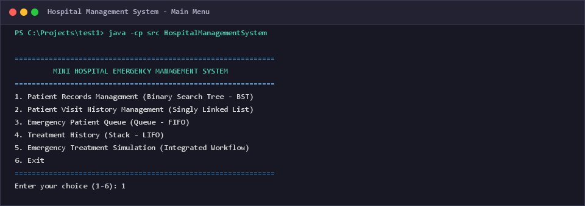
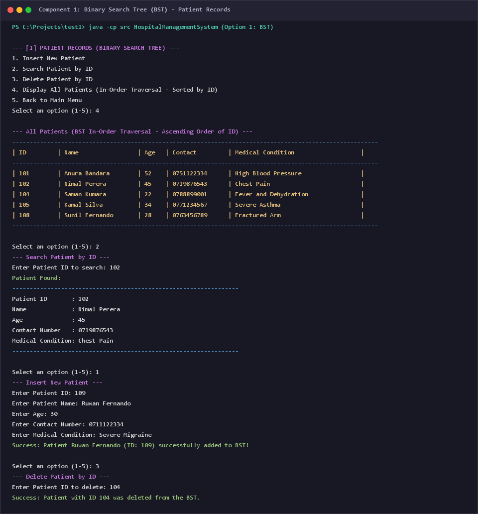
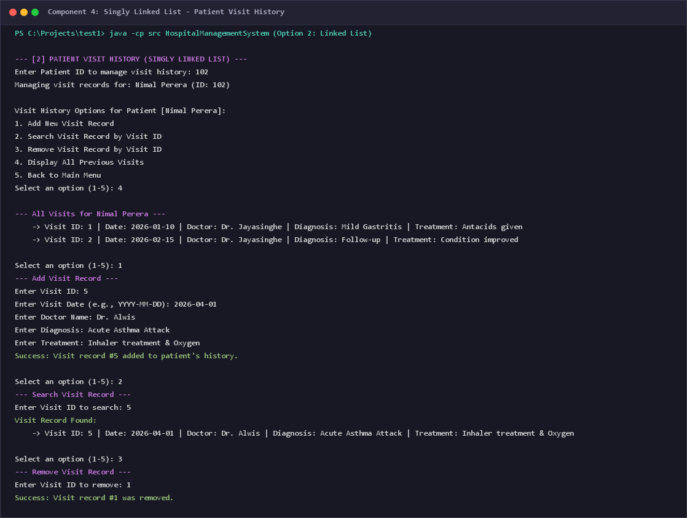
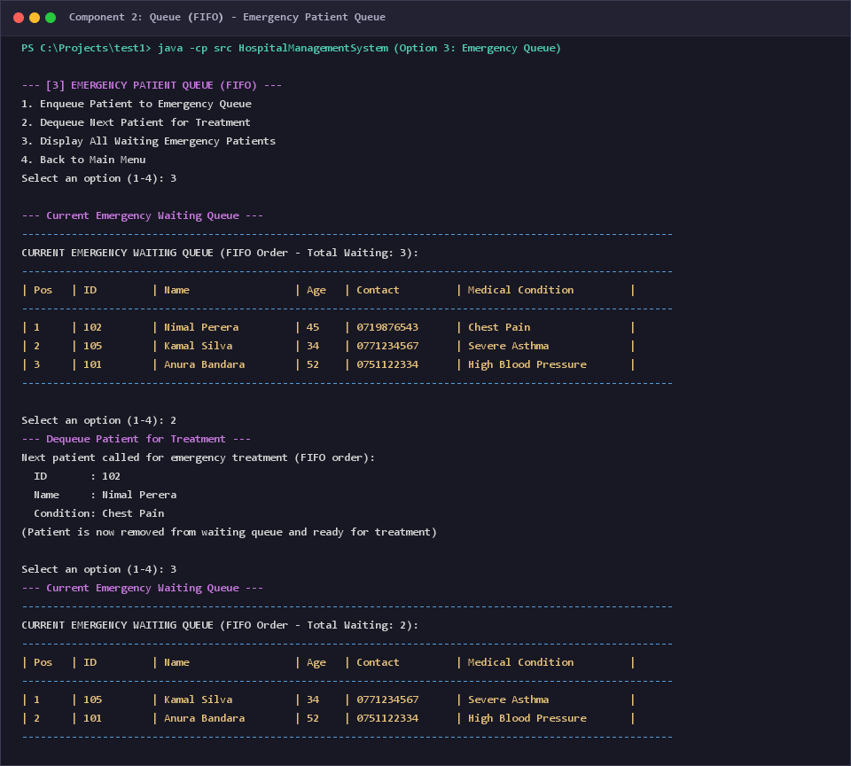
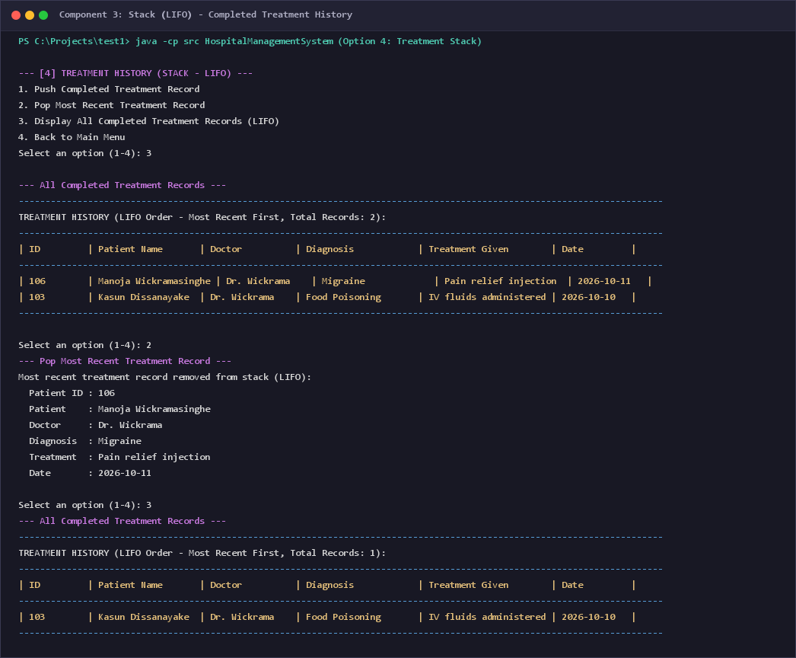
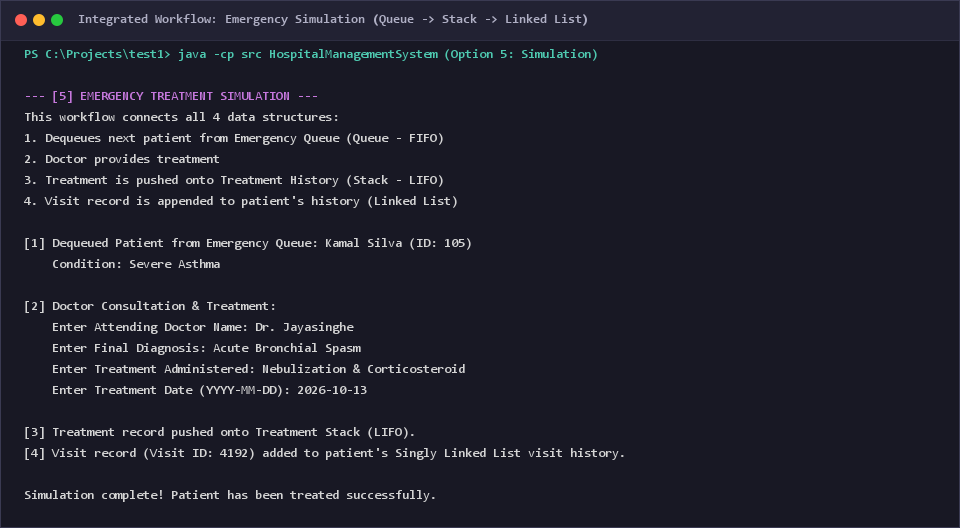
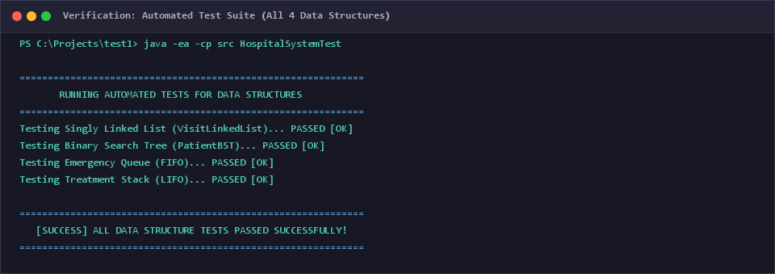

# CIT300 - Data Structures and Algorithms
## Individual Mid Assignment: Mini Hospital Emergency Management System

**Student Name:** Arshath Rizvi  
**Course:** CIT300 - Data Structures and Algorithms  
**Assignment Title:** Mini Hospital Emergency Management System Using Data Structures  
**Technology:** Java (JDK 17+)

---

## 1. Project Overview

The **Mini Hospital Emergency Management System** is a console-based healthcare management simulation developed in Java. It models the core operational lifecycle of an emergency hospital unit:
1. **Patient Registration & Records:** Storing and retrieving patient profiles efficiently.
2. **Emergency Queueing:** Managing arriving emergency patients in real time based on their arrival order.
3. **Emergency Treatment & History:** Tracking treated cases in reverse-chronological order.
4. **Patient Visit History:** Keeping an individualized medical consultation timeline for each patient.

The core objective of this project is to implement fundamental data structures from scratch (without relying on Java's built-in `java.util` collection wrappers) to demonstrate custom node-pointer manipulation and algorithmic problem-solving.

---

## 2. Data Structures Implemented

The system incorporates four custom-built data structures:

### A. Patient Records — Binary Search Tree (BST) [20 Marks]
- **Class:** `PatientBST.java`, `BSTNode.java`, `Patient.java`
- **Key Used:** `patientId` (Integer)
- **Principle:** Left subtree keys `<` Root key `<` Right subtree keys.
- **Implemented Operations:**
  - `insert(Patient patient)`: Recursively places the patient into the correct tree position based on `patientId`. Rejects duplicate IDs.
  - `search(int patientId)`: Recursively searches by `patientId` in $O(\log n)$ average time complexity.
  - `delete(int patientId)`: Handles all three standard BST deletion cases:
    1. **Leaf node (0 children):** Node removed directly.
    2. **Single child (1 child):** Node replaced by its child.
    3. **Two children (2 children):** Node replaced with its *in-order successor* (the minimum node from the right subtree), and successor is deleted.
  - `inOrderTraversal()`: Traverses the tree in `Left -> Root -> Right` order, displaying all registered patients in ascending order of their `patientId`.

### B. Emergency Patient Queue — Queue (FIFO) [20 Marks]
- **Class:** `EmergencyQueue.java`, `QueueNode.java`
- **Principle:** First-In, First-Out (FIFO). The first patient to arrive at the emergency unit is the first to be called for treatment.
- **Implemented Operations:**
  - `enqueue(Patient patient)`: Appends a newly arrived patient to the rear of the queue.
  - `dequeue()`: Removes and returns the patient at the front of the queue for doctor consultation.
  - `displayQueue()`: Displays all patients currently waiting in order of position.
  - **Empty Queue Handling:** Returns `null` and displays a clear message if `dequeue()` is called on an empty queue.

### C. Treatment History — Stack (LIFO) [20 Marks]
- **Class:** `TreatmentStack.java`, `StackNode.java`, `TreatmentRecord.java`
- **Principle:** Last-In, First-Out (LIFO). The most recently completed treatment is at the top of the stack.
- **Implemented Operations:**
  - `push(TreatmentRecord record)`: Places a completed treatment entry onto the top of the stack.
  - `pop()`: Removes and returns the most recently completed treatment record from the top.
  - `displayHistory()`: Iterates from `top` downward, displaying records in reverse-chronological order.
  - **Empty Stack Handling:** Returns `null` and prevents errors if `pop()` is invoked on an empty stack.

### D. Patient Visit History — Singly Linked List [20 Marks]
- **Class:** `VisitLinkedList.java`, `VisitNode.java`, `VisitRecord.java`
- **Principle:** Dynamic sequential list of previous medical visits attached to each individual `Patient` instance.
- **Implemented Operations:**
  - `addVisit(VisitRecord visit)`: Appends a new consultation visit to the end of the patient's visit chain.
  - `removeVisit(int visitId)`: Unlinks and deletes a visit record matching the given `visitId`.
  - `searchVisit(int visitId)`: Sequentially traverses the list to find a specific visit record.
  - `displayVisits()`: Traverses and prints all previous hospital visits for the patient.

---

## 3. Project Structure

```
c:\Projects\test1\
│
├── .gitignore                          # Git ignore rules for compiled classes
├── README.md                           # Comprehensive documentation
│
├── screenshots/                        # Program output verification screenshots
│   ├── 01_main_menu.png
│   ├── 02_bst_patient_records.png
│   ├── 03_patient_visit_history.png
│   ├── 04_emergency_queue.png
│   ├── 05_treatment_stack.png
│   ├── 06_emergency_simulation.png
│   └── 07_automated_test_suite.png
│
└── src/                                # Java source code
    ├── BSTNode.java                    # Node class for Patient BST
    ├── EmergencyQueue.java             # Custom linked Queue (FIFO)
    ├── HospitalManagementSystem.java   # Main interactive console CLI application
    ├── HospitalSystemTest.java         # Automated verification test suite
    ├── Patient.java                    # Patient entity model
    ├── PatientBST.java                 # Custom Binary Search Tree implementation
    ├── QueueNode.java                  # Node class for Emergency Queue
    ├── ScreenshotGenerator.java        # Utility to generate terminal output screenshots
    ├── StackNode.java                  # Node class for Treatment Stack
    ├── TreatmentRecord.java            # Treatment record entity model
    ├── TreatmentStack.java             # Custom linked Stack (LIFO)
    ├── VisitLinkedList.java            # Custom Singly Linked List implementation
    ├── VisitNode.java                  # Node class for Visit Singly Linked List
    └── VisitRecord.java                # Visit record entity model
```

---

## 4. How to Compile and Run

### Prerequisites
- Java Development Kit (JDK) 17 or higher installed.

### Option A: Running the Main Interactive System
1. Open PowerShell or Command Prompt in the project root directory.
2. Compile all Java source files:
   ```bash
   javac src/*.java
   ```
3. Run the interactive console application:
   ```bash
   java -cp src HospitalManagementSystem
   ```

### Option B: Running the Automated Test Suite
To automatically verify all operations (BST insert/search/delete, Queue enqueue/dequeue, Stack push/pop, Linked List add/search/remove):
```bash
java -ea -cp src HospitalSystemTest
```

---

## 5. Development History & Commit Evidence

The project was developed progressively with clear, modular commits:

| Commit Hash | Commit Message | Description |
| :--- | :--- | :--- |
| `0901b2c` | `Created project structure` | Setup repository, `.gitignore`, and folder layout |
| `17fe12b` | `Implemented patient visit history using Singly Linked List` | Created `VisitRecord`, `VisitNode`, and `VisitLinkedList` |
| `5ac1a3d` | `Implemented patient records using Binary Search Tree (BST)` | Created `Patient`, `BSTNode`, and initial `PatientBST` |
| `d516b9a` | `Added BST search and deletion operations` | Implemented full recursive search and 3-case BST deletion |
| `ab5ed46` | `Implemented emergency queue using Queue (FIFO)` | Created `QueueNode` and `EmergencyQueue` |
| `2a2c59f` | `Implemented treatment history using Stack (LIFO)` | Created `TreatmentRecord`, `StackNode`, and `TreatmentStack` |
| `f836fde` | `Added interactive console menu and system integration` | Built user-friendly console CLI with sample data and workflow |
| `f1c11e3` | `Added testing for all data structure operations` | Added `HospitalSystemTest` standalone verification suite |
| `2e85051` | `Updated README with documentation and execution instructions` | Comprehensive project report and user guide |
| *(Latest)* | `Added program output screenshots and updated documentation` | Verification screenshots of all 4 data structures |

---

## 6. Video Demonstration Guide (5 - 10 Minutes)

When recording your demonstration video:
1. **Introduction (1 min):**
   - Show your face on camera.
   - State your name, student ID, and course (*CIT300 - Data Structures and Algorithms*).
   - Give an overview of the Mini Hospital Emergency Management System.
2. **GitHub Repository & Commits (1 min):**
   - Open your GitHub repository in a browser or show `git log --oneline` in terminal.
   - Highlight the progressive commit history demonstrating your development process.
3. **Data Structures Explanation & Live Demo (5-6 mins):**
   - **BST (Patient Records):** Run option `1`. Show in-order traversal (sorted by Patient ID). Demonstrate searching for an existing patient (e.g. ID 102), inserting a new patient, and deleting a patient.
   - **Singly Linked List (Visit History):** Run option `2`. Select patient 102. Show existing visits, add a new visit, search for a visit, and remove a visit.
   - **Queue (Emergency Waiting Queue):** Run option `3`. Display the waiting queue. Dequeue the front patient (demonstrating FIFO).
   - **Stack (Treatment History):** Run option `4`. Display treatment history (demonstrating LIFO - most recent on top). Pop the top record.
   - **Integrated Flow:** Run option `5` to show how a patient moves from the emergency queue to doctor consultation, pushing to stack and adding to linked list history.
4. **Design Decisions & Reflection (1-2 mins):**
   - Explain why custom node-based implementations were chosen instead of built-in collections.
   - Reflect on learnings: recursive BST balancing/deletion complexity, pointer management in linked lists, and FIFO/LIFO real-world modeling.

---

## 7. Screenshots of Program Output

All program execution outputs are saved as high-resolution images in the `screenshots/` directory:

### 1. Main Menu Interface


### 2. Patient Records — Binary Search Tree (BST)
Demonstrates In-Order Traversal (sorted by Patient ID), Search by ID, Insert new patient, and Deletion:


### 3. Patient Visit History — Singly Linked List
Demonstrates displaying previous hospital visits, adding a new visit, searching, and removing:


### 4. Emergency Patient Queue — Queue (FIFO)
Demonstrates waiting queue display, FIFO dequeuing for treatment, and remaining queue state:


### 5. Treatment History — Stack (LIFO)
Demonstrates completed treatment records in LIFO order (most recent first) and pop operation:


### 6. Emergency Treatment Simulation (Integrated Workflow)
Demonstrates full cycle connecting all four data structures:


### 7. Automated Test Suite Verification
Demonstrates all data structures passing automated test assertions:


